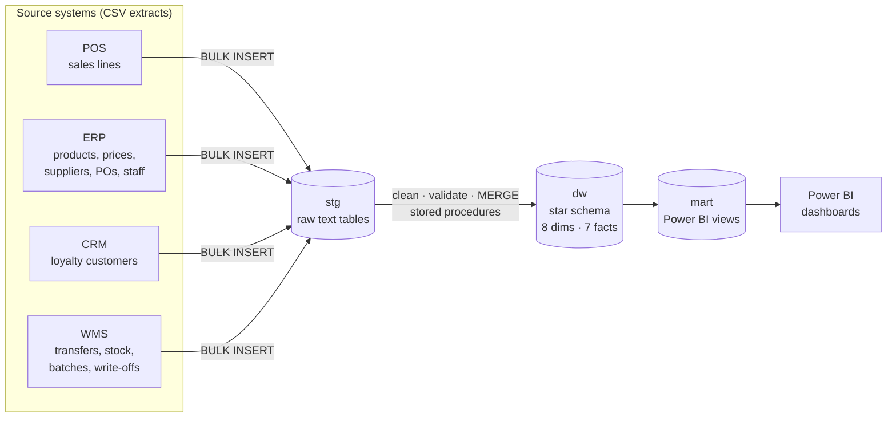

# Al Shifa Al Ajil Pharmacies: Enterprise Data Warehouse & SQL Analytics

**An end-to-end SQL Server data warehouse for a fictional 35-branch Saudi pharmacy chain:**
raw source-system extracts → staging → cleaned star schema → department analysis → Power BI-ready views.


---

## Business scenario

*Al Shifa Al Ajil* runs **35 branches** in Riyadh, Jeddah, Makkah, Madinah, the Eastern Province, Qassim and Abha,
supplied by **2 distribution centers** and **9 suppliers**. Every department keeps its data in a different
system (POS, ERP, CRM, warehouse management). Management cannot answer cross-department questions such as
*"did that promotion make money?"* or *"which supplier causes our stock-outs?"*.

This project builds the warehouse that brings those systems together, then answers the questions each
department head actually asks.

| Phase | Departments | Status |
|---|---|---|
| **1** | Sales · Category Management · Purchasing · Warehouse | ✅ This repository |
| 2 | HR (org hierarchy, promotions, attrition) · Training | Planned |
| 3 | Online orders · Insurance claims · Customer service & loyalty | Planned |
| 4 | Finance (branch P&L) · Quality & compliance · Maintenance | Planned |

## Architecture



**Data model:** conformed dimensions (date, location, product, supplier, employee, customer, promotion) shared
by one fact table per business process. Full diagram: [`docs/erd.png`](docs/erd.png) · column-level
details: [`docs/data_dictionary.md`](docs/data_dictionary.md).

## Key findings

Full write-up with every number: **[`docs/findings.md`](docs/findings.md)**

* **Net sales 279.4 M SAR in 2025 (+9.1 %), of which +5.2 % is like-for-like** growth from existing branches.
* **12 of 15 promotions bought volume but lost profit**: White Friday at 35 % off cut daily profit by 78 %, while a 15 % discount doubled volume at flat profit.
* **One supplier delivers late 97 % of the time**, and its products spend **4x more days out of stock** than the chain average.
* **Stock-outs cost about 5.8 M SAR of sales in two years**, half of it from three national drug shortages.
* **Ramadan moves the busiest hour to 22:00 (38 % busier than a normal day's peak)** and more than doubles fragrance sales.
* **Prescriptions are 45 % of sales but 34 % of profit**; 36 % of the range brings 80 % of revenue.

## What's inside

```
sql/
├── 00_create_database.sql          database + schemas (stg, ref, dw, mart)
├── 01_staging_tables.sql           raw landing tables, one per extract
├── 02_load_staging.sql             BULK INSERT of every CSV (24 monthly POS files)
├── 03_dw_tables.sql                star schema, columnstore index on the sales fact
├── 04_load_procedures.sql          cleaning + MERGE upserts + fact loads, dw.usp_load_all
├── 05_data_quality_checks.sql      audit: duplicates, orphans, reconciliation, business rules
├── 06_sales_analysis.sql           Sales Director         (10 questions)
├── 07_category_management.sql      Category Management    (9 questions)
├── 08_purchasing_and_suppliers.sql Purchasing Manager     (7 questions)
├── 09_warehouse_and_inventory.sql  Supply Chain           (8 questions)
└── 10_mart_views_for_power_bi.sql  reporting layer
scripts/
├── build_products.py               product master from the SFDA drugs list + retail reference prices
├── generate_data.py                simulates 2 years of operations → source CSV extracts
├── test_sql.py                     runs every SQL block on DuckDB to verify logic and results
└── make_erd.py                     draws docs/erd.png from the DDL
docs/
├── findings.md · data_dictionary.md · erd.png
└── results/                        output of every analysis query
data/reference/                     drug list, retail items, product master
```

## SQL techniques used

| Area | Where |
|---|---|
| Star schema, surrogate keys, unknown members, conformed dimensions | `03`, `04` |
| Staging → DW ELT with `MERGE` upserts and stored procedures | `04` |
| Data cleansing: `TRY_CAST`, `TRIM`/`UPPER`, de-duplication with `ROW_NUMBER` | `04`, `05` |
| Type-2 style validity ranges (price history joined on sale date) | `03`, `04` |
| Window functions: `LAG` (MoM/YoY), `RANK`, `NTILE`, running totals (ABC/Pareto) | `06`, `07`, `08` |
| CTE pipelines, conditional aggregation, pivots with `CASE` | everywhere |
| Difference-in-differences test of a price increase | `07` Q5 |
| Market-basket analysis (support & lift) with a self-join | `07` Q8 |
| Supplier OTIF scorecard, lead-time and delay distributions | `08` |
| Expiry risk and transfer-vs-markdown recommendation | `09` Q4 |
| Lost-sales estimation from stock-out events | `09` Q6 |
| Dynamic SQL + cursor for bulk loading, recursive CTE calendar, columnstore index | `02`, `03`, `04` |

## How to run it

**You need:** SQL Server 2019+ (free Developer or Express edition), SSMS or the VS Code *SQL Server (mssql)*
extension, and Python 3.10+.

```bash
# 1. generate the source extracts (scale 1.0 ≈ 9 M sales lines and ~850 MB; 0.3 is a quick laptop run)
pip install -r requirements.txt
python scripts/generate_data.py --scale 1.0 --out C:/AlShifaData/generated
```

```sql
-- 2. in SSMS, run the scripts in order
--    00 → 01 → 02 (set @root to your CSV folder first) → 03 → 04
EXEC dw.usp_load_all;          -- loads every dimension and fact
--    then 05 (data-quality audit) and 06-10 (analysis and Power BI views)
```

`scripts/test_sql.py` re-runs the whole pipeline on DuckDB (T-SQL transpiled with `sqlglot`). It is
how the logic and every number in `docs/findings.md` were verified:

```bash
python scripts/test_sql.py --data C:/AlShifaData/generated
```

## About the data

* **Drug names, strengths and public prices** come from the **Saudi Food & Drug Authority (SFDA) drugs list**
  (395 community-pharmacy items).
* **Beauty, personal care, vitamin and device items with shelf prices** come from a public Saudi pharmacy
  retail website (used as reference prices only).
* **Everything else is simulated**: the chain, branches, staff, customers, suppliers and every
  transaction are fictional. The simulation encodes patterns from first-hand pharmacy operations
  experience: winter flu season, Ramadan night trading, Eid gifting, Saudi Friday/Saturday weekends,
  chronic patients refilling every ~30 days, supplier delays, national shortages, promotions, price changes,
  new-branch ramp-up, plus realistic dirty data (duplicates, bad codes, returns, date errors) for the
  cleaning layer to handle.

## Author

**Hussieni Gamal**, Data Analyst · pharmacist by background (purchasing and sales for a 4-branch chain,
branch manager in Riyadh)

[LinkedIn](https://www.linkedin.com/in/hussieni-gamal-549b68134/) · [Portfolio](https://sites.google.com/view/hussienigamal/home) · [GitHub](https://github.com/HussieniGamal)
